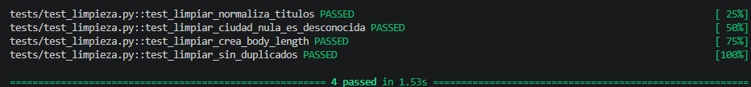
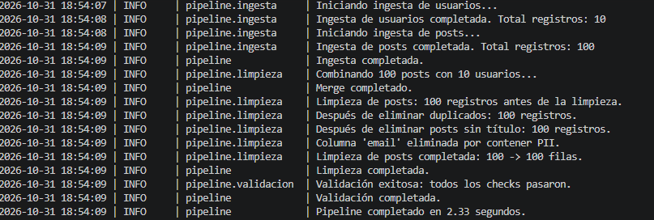

# Pipeline de Ingesta, Limpieza y Validación de Posts

Pequeño pipeline de ingeniería de datos profesional desarrollado en Python. Ingusta datos públicos de la API de **JSONPlaceholder**, los combina, limpia, valida bajo estrictas reglas de calidad y los exporta de forma optimizada en múltiples formatos (Parquet, CSV y base de datos SQLite).

---


## 🏗 Arquitectura del Pipeline

El flujo de datos sigue una arquitectura modular de 5 pasos claros:

1. **Ingesta (`src/ingesta.py`)**: Extracción robusta de usuarios y posts vía HTTP con reintentos automáticos y *backoff* exponencial.
2. **Merge (`src/limpieza.py`)**: Combinación de los posts con la información de su respectivo autor utilizando un `left join`.
3. **Limpieza (`src/limpieza.py`)**: Normalización de cadenas de texto (títulos, nombres de autor, ciudades), manejo de nulos, eliminación de duplicados y supresión de datos sensibles (PII como el `email`).
4. **Validación (`src/validacion.py`)**: Capa de control de calidad (guardián) mediante tests que aseguran que el esquema, las columnas obligatorias y los tipos de datos sean correctos antes de la exportación.
5. **Exportación (`src/exportar.py`)**: Almacenamiento final de los datos limpios en la carpeta `output/` (Formatos: `.parquet`, `.csv` y `.db` para consultas SQL).

---




## 📂 Estructura del Proyecto

```text
Pipeline_post/
│
├── src/
│   ├── __init__.py
│   ├── ingesta.py       # Extracción de APIs externas con reintentos
│   ├── limpieza.py      # Transformación, merge y limpieza de datos
│   ├── validacion.py    # Reglas de calidad de datos
│   ├── exportar.py      # Exportación a Parquet, CSV y SQLite
│   └── pipeline.py      # Orquestador principal (Entrypoint)
│
├── tests/
│   ├── __init__.py
│   └── test_limpieza.py # Tests unitarios de limpieza con pytest
│
├── output/              # Artefactos de salida generados (Ignorado en Git)
├── pipeline.log         # Registro detallado de ejecuciones (Ignorado en Git)
├── requirements.txt     # Dependencias del proyecto
└── README.md            # Documentación del proyecto

